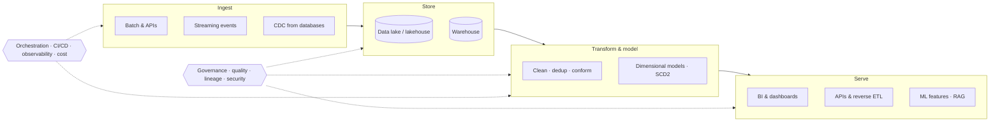

  

### Hi, I'm Sagar 👋

I build data platforms end to end, from the first byte ingested to the dashboard, API or AI model
that uses it, and I make them **notice when they break, and fix themselves**.
Five years of Spark, Databricks, Delta Lake, Airflow and BigQuery across e-commerce,
automotive, finance and industrial IoT. Most recently at eBay, migrating 300+ production pipelines.

- 🏭 **[The Data Foundry](https://data-foundry-sand.vercel.app)**: watch a live pipeline run, break it on purpose, and see it heal
- 🧪 **[spark-pipeline-labs](https://github.com/sagarkonkanagaon-netizenk/spark-pipeline-labs)**: production patterns (streaming dedup, SCD2, skew salting, idempotent backfills) as tested PySpark + Delta code
- 📓 **[til](https://github.com/sagarkonkanagaon-netizenk/til)**: short notes on what I learn each week

### 🗺️ The whole data engineering lifecycle

| Stage | What I care about |
|---|---|
| **Ingestion** | Batch loads, REST/API pulls, Kafka-style event streams and database CDC, with late and duplicate data handled on purpose |
| **Storage** | Lakehouse (Delta Lake) and warehouse (BigQuery) designs, file formats, partitioning, compaction and retention |
| **Processing** | Spark batch and Structured Streaming, SQL, incremental and exactly-once patterns, skew and shuffle tuning |
| **Data modeling** | Star schemas, facts and dimensions, SCD Type 2, layered models (raw, conformed, business) that people can trust |
| **Orchestration** | Airflow DAGs with retries, SLAs, backfills and deferrable sensors; event-driven runs where batch is too slow |
| **Data quality** | Contracts and tests at every boundary, freshness/volume/schema checks, quarantine instead of silent corruption |
| **Governance & security** | Catalogs, lineage, access control, PII masking, auditability |
| **Serving** | BI-ready marts, semantic layers, APIs and reverse ETL, ML feature tables |
| **DataOps** | Everything as code: Git, CI on every PR, Docker, tested pipelines, safe deploys and rollbacks |
| **Cost & performance** | Right-sized clusters, pruning, caching, Z-ordering, and knowing what each query costs |

### 🏛️ Architecture principles

- **Replayable by design**: raw data is kept, every step can be re-run, every write is idempotent
- **Fail loudly, heal quietly**: bad data is stopped at the edge, and known failures repair themselves
- **Batch and streaming, one model**: the same logic serves both, so numbers agree
- **Built for the next reader**: documented tables, clear ownership, lineage you can follow

### ☁️ Cloud-native implementation

- **Compute:** Databricks and Spark clusters that autoscale, serverless SQL where it fits
- **Storage:** cloud object storage with Delta Lake tables, BigQuery for analytics
- **Platform:** containers, infrastructure as code, secrets and access managed centrally
- **Delivery:** CI/CD for pipelines like any other software, with tests before anything touches prod

### 🤖 AI on top of the data

- **LLM apps on real data:** The Data Foundry's "Ask the Engine" chat answers questions with retrieval (BM25) over curated content
- **AI-ready data:** clean, documented tables that feed ML features and RAG instead of a pile of CSVs
- **AI for operations:** pipelines that detect drift and anomalies and repair themselves

### 🧰 Toolbox

**Currently:** open to Senior Data Engineer roles ·
[LinkedIn](https://www.linkedin.com/in/sagar-konkanagaon-346914156) ·
[sagarkonkanagaon@gmail.com](mailto:sagarkonkanagaon@gmail.com)
