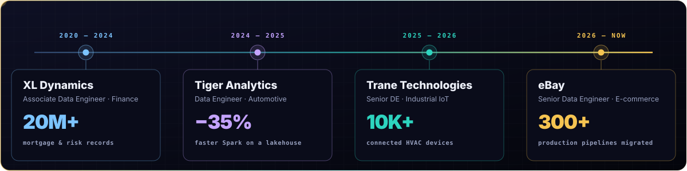
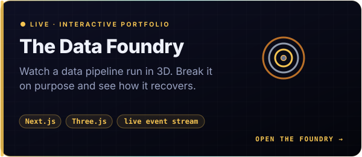
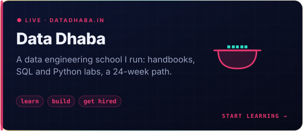
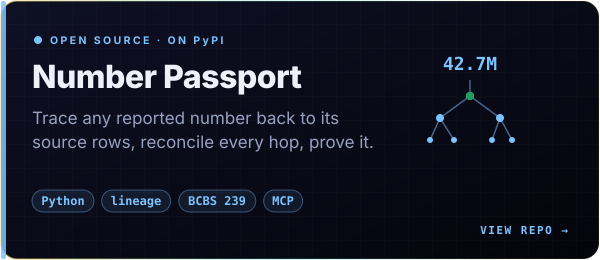
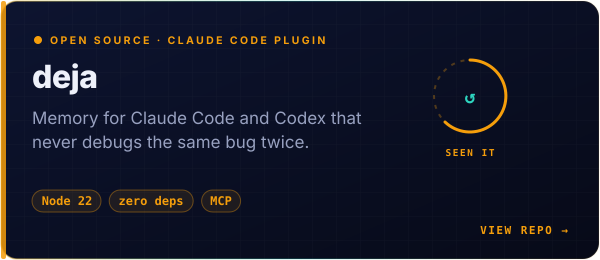
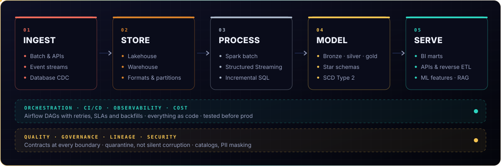
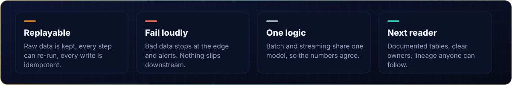
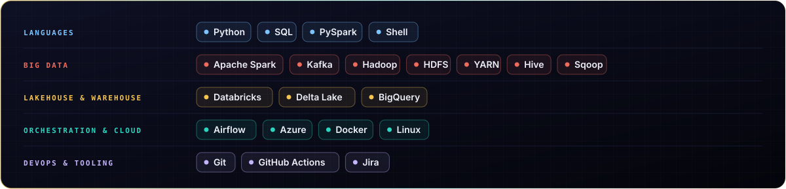

  

  <a href="https://data-foundry-sand.vercel.app"><b>The Data Foundry</b></a> ·
  <a href="https://datadhaba.in"><b>Data Dhaba</b></a> ·
  <a href="https://www.linkedin.com/in/sagar-konkanagaon-346914156"><b>LinkedIn</b></a> ·
  <a href="mailto:sagarkonkanagaon@gmail.com"><b>Email</b></a>

I build data platforms end to end, from the first byte ingested to the dashboard, API or AI model that uses it, built to be **reliable, observable and easy to trust**.
Five years of Spark, Databricks, Delta Lake, Airflow and BigQuery across e-commerce, automotive, finance and industrial IoT. Most recently at eBay, migrating **300+ production pipelines**.

  
  
  
  

  Also: <a href="https://github.com/sagarkonkanagaon-netizenk/spark-pipeline-labs"><b>spark-pipeline-labs</b></a> (streaming dedup, SCD2, skew salting and idempotent backfills as tested PySpark + Delta code) ·
  <a href="https://github.com/sagarkonkanagaon-netizenk/til"><b>til</b></a> (short notes on what I learn each week)

<b>Stage by stage: what I care about</b>

 

| Stage | What I care about |
|---|---|
| **Ingestion** | Batch loads, REST/API pulls, Kafka-style event streams and database CDC, with late and duplicate data handled on purpose |
| **Storage** | Lakehouse (Delta Lake) and warehouse (BigQuery) designs, file formats, partitioning, compaction and retention |
| **Processing** | Spark batch and Structured Streaming, SQL, incremental and exactly-once patterns, skew and shuffle tuning |
| **Data modeling** | Star schemas, facts and dimensions, SCD Type 2, layered models (raw, conformed, business) that people can trust |
| **Orchestration** | Airflow DAGs with retries, SLAs, backfills and deferrable sensors; event-driven runs where batch is too slow |
| **Data quality** | Contracts and tests at every boundary, freshness/volume/schema checks, quarantine instead of silent corruption |
| **Governance & security** | Catalogs, lineage, access control, PII masking, auditability |
| **Serving** | BI-ready marts, semantic layers, APIs and reverse ETL, ML feature tables |
| **DataOps** | Everything as code: Git, CI on every PR, Docker, tested pipelines, safe deploys and rollbacks |
| **Cost & performance** | Right-sized clusters, pruning, caching, Z-ordering, and knowing what each query costs |
| **AI on top** | Clean, documented tables that feed ML features and RAG; retrieval-backed chat like The Data Foundry's "Ask the Engine" |

  

  <a href="https://www.linkedin.com/in/sagar-konkanagaon-346914156">LinkedIn</a> ·
  <a href="mailto:sagarkonkanagaon@gmail.com">sagarkonkanagaon@gmail.com</a> ·
  <a href="https://data-foundry-sand.vercel.app">data-foundry-sand.vercel.app</a> ·
  <a href="https://datadhaba.in">datadhaba.in</a>

